# Frindo build guide

How to build the Frindo chassis, then turn it into a teleoperated ROS 2 robot with a Raspberry Pi 5
and camera.

The chassis takes 12 steps. Steps 13 and 14 power it up and configure Motion Core MC1. Step 15 adds
the Raspberry Pi and camera, and is one example of what you can fit to the deck. Steps 16 and 17 set
up the software and get the robot driving.

- [Parts to print](#parts-to-print)
- [Bill of materials](#bill-of-materials)
- [Battery safety](#battery-safety)
- [Chassis build](#chassis-build)
- [Power-up and configuration](#power-up-and-configuration)
- [Adding a Raspberry Pi and camera](#adding-a-raspberry-pi-and-camera)
- [Software](#software)

---

## Parts to print

Print time is about 8 hours for everything below, using roughly 310 g of PLA. The main components
take about 6 hours and 252 g. The STL files are in [`3D files`](3D%20files), with ready-made print
sets in each folder's `.3mf` file.

### Chassis

| Part | File | Qty | PLA each | Time each |
|---|---|---|---|---|
| Chassis plate | `chassis/3D Printed base.stl` | 1 | 134 g | 170 min |
| Wheel hub | `chassis/50mm Wheel Hub for O-ring.stl` | 2 | 4 g | 10 min |
| 15 mm PCB stand-off | `chassis/MC1 stand off.stl` | 4 | 0.5 g | 4 min |
| Deck | `deck/Deck plate.stl` | 1 | 92 g | 127 min |
| 70 mm deck stand-off | `deck/Deck stand off.stl` | 4 | 4 g | 6 min |

### Optional accessories

Print only the ones you need.

| Part | File | Qty in this build | PLA each | Time each |
|---|---|---|---|---|
| Sharp sensor bracket | `accessories/Sharp sensor bracket.stl` | 3 | 4 g | 10 min |
| Toggle switch bracket | `accessories/Toggle switch bracket.stl` | 1 | 5 g | 14 min |
| Raspberry Pi mount | `accessories/Pi Mount.stl` | 1 | 11 g | 18 min |
| Raspberry Pi camera mount | `accessories/Pi Camera Mount.stl` | 1 | 6 g | 18 min |
| Pi Zero mount | `accessories/Pi Zero Mount.stl` | Alternative | 13 g | 18 min |
| Pi Zero mount, vertical | `accessories/Pi Zero Mount - Vert.stl` | Alternative | 13 g | 25 min |

### Print settings

The times and weights above come from these settings, on a Bambu Lab P1S. All parts use the same
settings, and the `.3mf` files already contain them:

| Setting | Value |
|---|---|
| Material | PLA |
| Nozzle | 0.4 mm |
| Layer height | 0.2 mm |
| Walls | 2 |
| Infill | 30% |
| Supports | Automatic (30° overhang threshold), off for the stand-offs |

---

## Bill of materials

### Chassis

| Item | Qty | Step |
|---|---|---|
| [50 mm OD, 40 mm ID O-ring](https://www.amazon.co.uk/dp/B0GSZ66ZXH?th=1) | 2 | 2 |
| [Miniature ball castor](https://www.amazon.co.uk/dp/B0CQ721G26?th=1). Do not use the self-adhesive pads | 2 | 3 |
| [12 V, 47:1 metal gearmotor with 48 CPR encoder](https://www.pololu.com/product/4885) (Pololu item #4885 or equivalent) | 2 | 5 |
| [Battery pack](https://www.amazon.co.uk/dp/B0928GTP85) (this build uses an 11.1 V, 5200 mAh LiPo with an XT60 connector) | 1 | 7 |
| [25 mm wide Velcro strap](https://www.amazon.co.uk/dp/B0GGH11QQN?th=1): about 220 mm cut from a roll plus a buckle, or a 200 mm pre-cut strap with an integrated buckle | 1 | 7 |
| [Motion Core MC1 PCB](https://firstlayerrobotics.com/shop), USB version. Comes with the JP1 jumper | 1 | 9 |
| [Motion Core Cable Kit](https://firstlayerrobotics.com/shop): motor, encoder, E-stop/charger and aux 5 V cables | 1 | 9 |
| [Motion Core Shorting Jumper Links (pair)](https://firstlayerrobotics.com/shop), for J2 and J3 if you are not fitting switches | 1 | 9 |
| 3S LiPo balance charger | 1 | [Battery safety](#battery-safety) |
| M3 x 8 mm screws | 16 | 3, 4, 5, 9 |
| M3 x 10 mm screws | 8 | 11, 12 |

The screws, nuts and washers in this guide are standard metric hardware, available from any good
fastener supplier or as an assorted kit. Keep to the stated lengths.

### Optional chassis accessories

| Item | Qty | Step |
|---|---|---|
| M3 x 8 mm screws | 2 per bracket | 8 |
| M3 nuts | 2 per bracket in a 45° position | 8 |
| [Battery switch](https://www.amazon.co.uk/dp/B0B8YM8N7W?th=1), pre-wired in an in-line lead with an XT60 connector at each end. Or a short battery extension cable if you need the extra reach | 1 | 10 |

### Raspberry Pi and camera

| Item | Qty | Step |
|---|---|---|
| [Raspberry Pi 5](https://www.raspberrypi.com/products/raspberry-pi-5/), 4 GB minimum. 4 GB is enough for this guide, but 8 GB is recommended if you plan to run SLAM, Nav2 or similar | 1 | 15 |
| Low-profile heatsink for the Raspberry Pi 5 | 1 | 15 |
| [Raspberry Pi Camera Module 3 Wide](https://www.raspberrypi.com/products/camera-module-3/) | 1 | 15 |
| 200 mm Raspberry Pi 5 camera adapter cable | 1 | 15 |
| 64 GB A2-rated microSD card | 1 | 16 |
| M3 x 10 mm screws, M3 washers and M3 nuts, to fix the Pi or Pi Zero mount to the deck | 4 of each | 15 |
| M2.5 x 5 mm screws, to fix the Pi or Pi Zero to its mount | 4 | 15 |
| M3 x 10 mm screws, M3 washers and M3 nuts, to fix the camera mount to the deck | 4 of each | 15 |
| M2 x 10 mm screws, M2 washers and M2 nuts, to fix the camera module to its mount | 4 of each | 15 |
| USB-C to USB data cable, between MC1 and the Pi 5 | 1 | 15 |
| USB-C pigtail cable, to power the Pi from MC1 | 1 | 15 |

---

## Battery safety

> [!WARNING]
> **Please read this before you start.** This build uses a 3S LiPo pack. LiPo batteries are safe
> with sensible handling, but they can catch fire if they are damaged, short-circuited, overcharged
> or badly over-discharged.
>
> | | What to do |
> |---|---|
> | 🔌 **Charging** | Take the pack out of the robot and use a 3S LiPo balance charger. Never leave it charging unattended, and keep it on a non-flammable surface or in a LiPo charging bag. Do not charge a 5200 mAh pack above 5.2 A (1C). |
> | 🔧 **Short circuits** | Keep the battery connector away from metal tools and loose screws, and leave the pack unplugged while you work on the robot. |
> | 🔋 **Low voltage** | MC1's default settings suit a 3S pack. It warns at 9.9 V and stops the motors at 9.0 V. This does not disconnect the battery, and MC1 and the Raspberry Pi keep drawing current, so shut down and switch off once you get a low-battery warning. |
> | 💤 **After use** | Always switch off or unplug the battery. A pack left connected can discharge below the point where it is safe to recharge. |
> | 📦 **Storage** | For anything longer than a few days, store the pack at about 3.8 V per cell (11.4 V), somewhere cool and away from anything flammable. |
> | ♻️ **Damage** | Stop using a pack that is swollen, punctured, hot or has damaged wires. Dispose of it at a battery recycling point, not in household waste. |

---

## Chassis build

### Step 1: Print the parts

Print all the 3D printed parts and remove any supports.

> **Important:** make sure all swarf has been removed from the printed parts before you begin. You
> don't want small pieces of plastic getting into the motor gearboxes!

[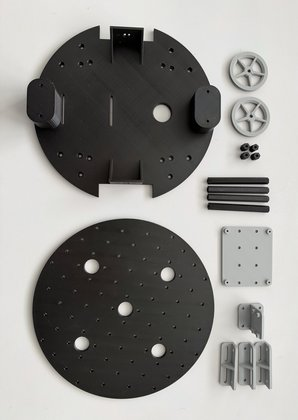](guide-images/1.jpg)

### Step 2: Build the wheels

Place the 50 mm O-rings onto the printed wheel hubs. The O-rings should be a good fit and need no
glue to hold them in place. The finished wheel has a 52 mm diameter.

**You will need:** 2x printed wheel hubs, 2x 50 mm OD, 40 mm ID O-rings

[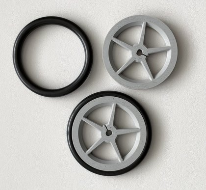](guide-images/5.jpg)

### Step 3: Fit the castors

Fit the castors to the bottom of the chassis using four M3 x 8 mm screws. The screws thread directly
into the printed base, so do not over-tighten them.

> **Note:** do not use the self-adhesive pads supplied with the castors.

**You will need:** 4x M3 x 8 mm screws, 2x miniature ball castors, 1x printed chassis plate

[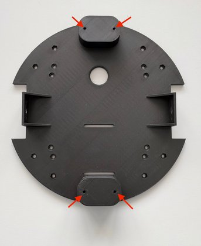](guide-images/2.jpg) [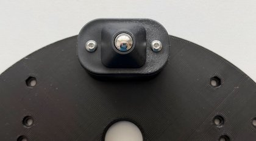](guide-images/3.jpg) [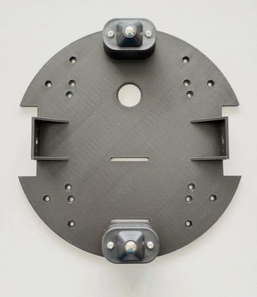](guide-images/4.jpg)

### Step 4: Fit the PCB stand-offs

Fit the four hexagonal 15 mm PCB stand-offs using one M3 x 8 mm screw for each. The screws thread
directly into the printed stand-offs, so do not over-tighten them. Fit each stand-off to the
inner-most set of recessed holes.

**You will need:** 4x M3 x 8 mm screws, 4x printed 15 mm stand-offs

[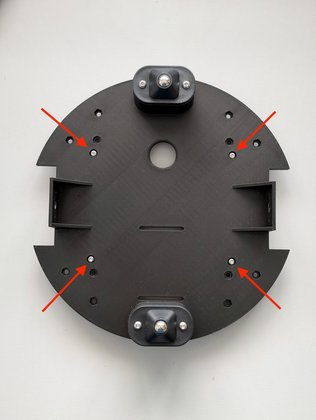](guide-images/7.jpg) [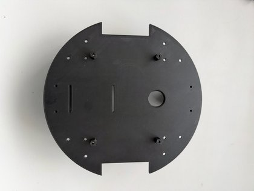](guide-images/8.jpg)

### Step 5: Fit the motors

Fit the motors using two M3 x 8 mm screws per motor. Orient the motors so that the motor and encoder
wires exit nearest the large pass-through hole in the chassis. Once they are fitted, pass the wires
through that hole.

> **Important:** do NOT use any screws longer than 8 mm, as this will damage the gearbox!

**You will need:** 4x M3 x 8 mm screws, 2x gearmotors with encoders

[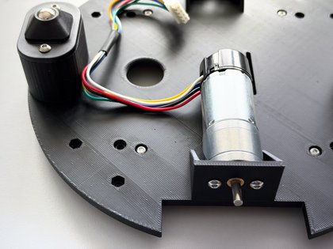](guide-images/9.jpg) [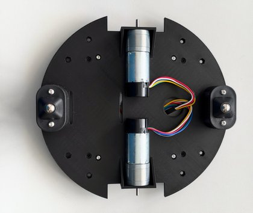](guide-images/10.jpg)

### Step 6: Fit the wheels

The wheels are a simple push-fit onto the output shaft of each motor gearbox. Align the D-shaped
cut-out in the wheel with the D-shaped shaft, then push the wheel on until its outside is flush with
the end of the shaft.

> **Note:** once the chassis is on its wheels, there should be a very small forward-backward rocking
> motion. This is deliberate, to make sure the wheels always make good contact with the ground.

**You will need:** the 2 wheels from step 2

[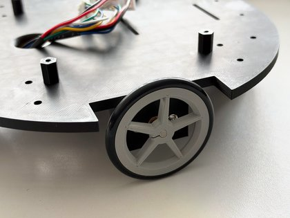](guide-images/11.jpg) [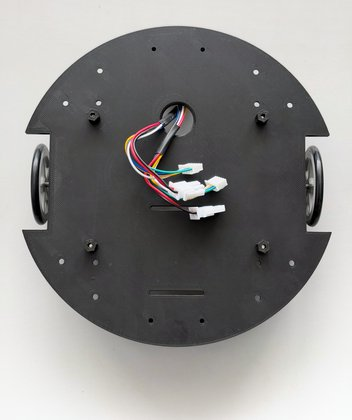](guide-images/12.jpg)

### Step 7: Test-fit the battery pack

This needs a 25 mm wide Velcro strap. You can use about 220 mm from a cut-to-length roll with a
separate buckle, as in these photos, or a 200 mm pre-cut strap with a buckle.

The strap fits through the two slots, with the free end and buckle on the underside of the robot.
Once you are happy with the fit, remove the battery but leave the strap in place. This gives you
access to the remaining recessed holes used in step 11.

**You will need:** the battery pack and Velcro strap

[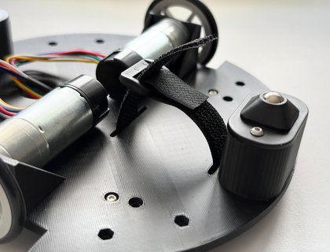](guide-images/13.jpg) [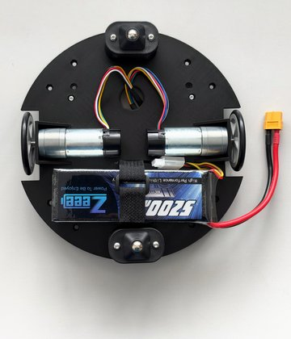](guide-images/14.jpg)

### Step 8: Fit the optional accessory brackets

The brackets you choose depend on your application. In this example, we fit a power switch bracket at
the back and three forward-facing Sharp sensor brackets. It is easier to fit the brackets before
fitting the sensor or switch.

Each bracket is attached with two M3 x 8 mm screws:

- **Front or rear position:** the screw threads directly into the printed chassis.
- **45° positions:** insert an M3 nut into the captive nut recess in the bottom of the chassis.

> **Note:** this build fits the Sharp sensor brackets ready for later, but leaves them empty. MC1 has
> no sensor input, and the software in this guide does not read these sensors. Sharp distance sensors
> with an analog output also need an analog-to-digital converter, because the Raspberry Pi has no
> analog inputs.

**You will need:** your chosen brackets, 2x M3 x 8 mm screws per bracket, and 2x M3 nuts per bracket in
a 45° position

[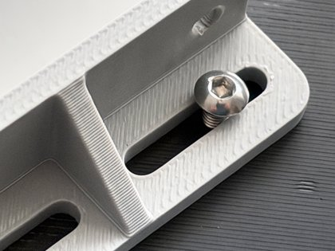](guide-images/15.jpg) [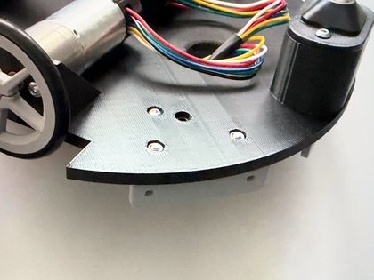](guide-images/16.jpg) [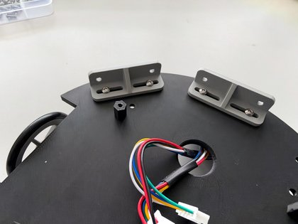](guide-images/17.jpg) [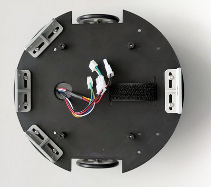](guide-images/18.jpg) [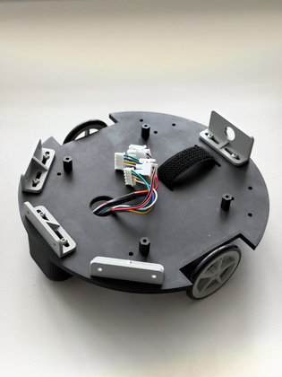](guide-images/19.jpg)

### Step 9: Fit Motion Core MC1

Fit the MC1 PCB to the four PCB stand-offs using four M3 x 8 mm screws.

Before you plug in the encoders, fit the jumper supplied with MC1 on JP1 (`ENC VOLTAGE`) between pin 1 (5 V) and pin 2
(`ENC_VCC`). This selects 5 V as the supply to both encoders. The encoders will not work with JP1
left open.

Then connect the motor and encoder cables, noting the correct left/right orientation when viewed from
above:

| Connection | Left | Right |
|---|---|---|
| Motor | J9 | J11 |
| Encoder | J8 | J10 |

> **Note:** MC1 has safety E-stop (J3) and Charger connected (J2) inputs, and the motors will not run
> if either is left open. If you do not want to use these functions, you need to fit a jumper link
> between pins 1 and 2 of J2 and J3. It is easier to do that now.
>
> **Important:** with a link fitted to J3, the robot has no hardware E-stop. That is fine on the
> bench, but fit a real normally-closed E-stop switch if the robot will be running near people.

**You will need:** 1x Motion Core MC1 PCB, 4x M3 x 8 mm screws, the JP1 jumper supplied with MC1, the motor and
encoder cables from the Cable Kit, and 2x links for J2 and J3 if you are not fitting switches

[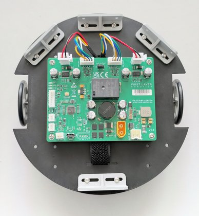](guide-images/20.jpg) [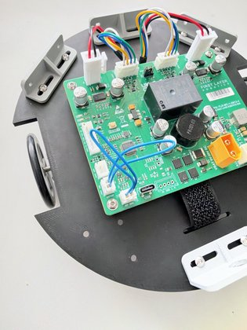](guide-images/21.jpg)

### Step 10: Fit the optional battery switch

If you are fitting the optional battery switch, fit it now. If you do not fit a switch, you may need a
short battery extension cable so that the battery connection can reach the MC1 board.

Keep the battery unplugged, and set the switch to off. Pass the switch through the toggle switch
bracket and secure it with its nut. The switch in this build sits in an in-line lead with an XT60
connector at each end:

1. Plug one end of the lead into J1 (`VBAT 9V-20V DC`) on MC1.
2. Leave the other end free, ready for the battery.

XT60 connectors only fit one way round, so do not force them. If you make up your own lead, switch
the positive wire only, match the `+` marking at J1, and use a switch rated for at least 15 A DC.

**You will need:** 1x battery switch, or a short battery extension cable

[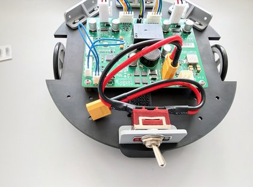](guide-images/22.jpg)

### Step 11: Fit the deck stand-offs

Turn the robot over. Fit the four hexagonal 70 mm deck stand-offs using one M3 x 10 mm screw for each, working from the underside. The screws thread
directly into the printed stand-offs, so do not over-tighten them. Fit each stand-off to the
outer-most set of recessed holes.

**You will need:** 4x M3 x 10 mm screws, 4x printed 70 mm stand-offs

[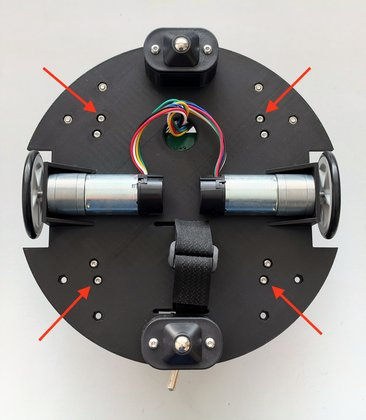](guide-images/23.jpg) [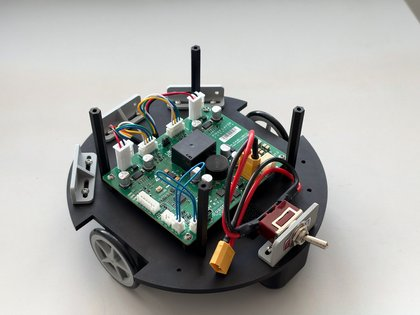](guide-images/24.jpg)

### Step 12: Fit the deck

Turn the robot back onto its wheels and fit the deck using four M3 x 10 mm screws.

**You will need:** 4x M3 x 10 mm screws, 1x printed deck

[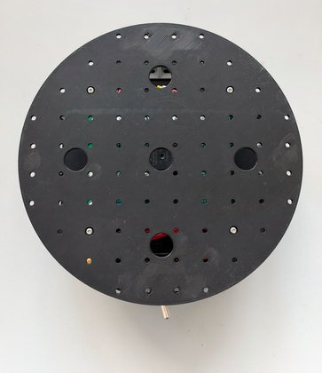](guide-images/25.jpg) [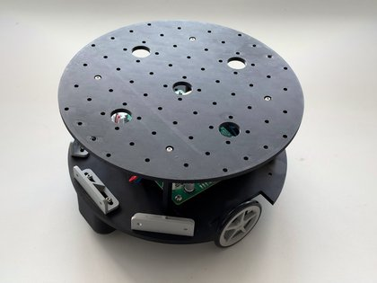](guide-images/26.jpg)

That completes the chassis. You can now re-fit the battery, leaving it unplugged.

---

## Power-up and configuration

It is easiest to configure MC1 now, while the deck is clear, because you can turn the robot upside
down and rest it on its deck with the wheels free. These steps use the
[Motion Core Getting Started guide for ROS 2](https://firstlayerrobotics.com/Motion_Core_Getting_Started_ROS2_Rev_C.pdf),
referred to below as the MC1 guide, which has the full detail. Here, we only cover what is specific
to Frindo.

### Step 13: First power-up

Check these before you plug in the battery:

- The JP1 jumper is fitted, and J2 and J3 have a link or a switch.
- The motor and encoder cables are on the correct left and right connectors.
- The robot is upside down, resting on its deck with the wheels free.

Plug in the battery and turn on the switch. The red LED on MC1 should blink about once a second, which
means its firmware is running. MC1 needs battery power even when it is connected over USB, because its
USB port does not power the board.

If you need to stop the robot at any point, turn off the switch or unplug the battery.

### Step 14: Configure MC1 for Frindo

Connect MC1 to a computer over USB and open the
[Motion Core configurator](https://firstlayerrobotics.com/motion-core/configurator) in Chrome or Edge.
Then work through sections 5 to 7 of the MC1 guide, in this order, using these values:

1. **Check the directions.** Do this with the robot upside down, as described in section 5. If a
   wheel turns the wrong way or reports the wrong direction, fix it in the settings rather than by
   changing the wiring.
2. **Measure `motor.max_rads`.** Turn the robot the right way up and put it on the floor for this,
   because a motor with its wheels in the air reads too high. Allow some clear space, and use a USB
   cable long enough to follow the robot. Section 6 of the MC1 guide gives the command, and the tool
   is in the resources section of the [Motion Core page](https://firstlayerrobotics.com/motion-core).
3. **Set the geometry and speed limits** from the table below, then check them by driving the robot on
   the floor, as described in section 5.
4. **Tune the velocity loop** with **Start Tuning** in the configurator. You can turn the robot upside
   down again for this. The wheels will turn for a minute or two.
5. **Save the settings.** Nothing survives a power cycle until you save. Turn the robot off and on
   again, then check that the values are still there.

| Setting | Value for Frindo | Notes |
|---|---|---|
| `kin.counts_per_rev` | 2249 | Factory default, and correct for the motor in this guide (46.85 x 48) |
| `kin.wheel_radius` | 0.026 | Starting value for the 52 mm wheel. Check it with a 1 m drive |
| `kin.track_width` | 0.172 | Starting value. Check it with a 360° spin |
| `motor.max_rads` | Measure it | Factory default is 8.0. Do not take this from the motor's datasheet |
| `kin.max_v` | 0.208 with `max_rads` at 8.0 | `motor.max_rads` x `kin.wheel_radius` |
| `kin.max_w` | 2.419 with `max_rads` at 8.0 | `motor.max_rads` x 2 x `kin.wheel_radius` / `kin.track_width` |

> **Important:** recalculate `kin.max_v` and `kin.max_w` whenever `motor.max_rads` or the wheel radius
> changes. The factory defaults are for a larger wheel. If these limits are wrong, the robot feels
> sluggish rather than reporting a fault.

The factory battery settings already suit a 3S LiPo. Close the configurator when you have finished,
because only one program can use MC1's USB port at a time.

Then turn off the switch, unplug the battery and disconnect the computer. You can now decide on the
electronics and sensors you want to use to drive the robot.

---

## Adding a Raspberry Pi and camera

In this example, we use a Raspberry Pi 5 and a Wide-angle Raspberry Pi Camera Module 3 to build a
complete ROS 2 based teleoperated robot.

### Step 15: Fit the Raspberry Pi and camera

Keep the battery unplugged for this step.

1. **Fit the mounts.** Print the accessories you are going to use and remove any support material.
   Fit the camera mount at the front edge of the deck and the Pi mount near the middle, as in the
   photos, using four M3 x 10 mm screws for each, with an M3 washer and nut on the underside of the
   deck.

[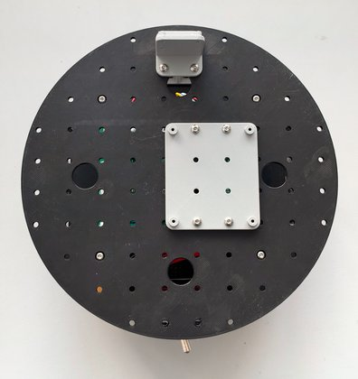](guide-images/27.jpg) [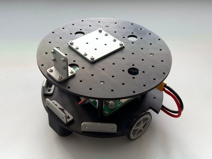](guide-images/28.jpg) [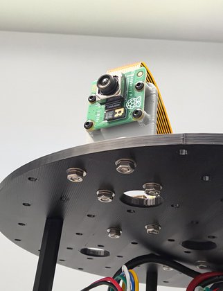](guide-images/29.jpg)

2. **Fit the Pi.** Fit the heatsink to the Pi 5 first, following the instructions that come with it.
   Then fix the Pi to its mount with four M2.5 x 5 mm screws, with its USB and Ethernet ports facing
   away from the camera.
3. **Fit the camera.** Fix the camera module to its mount with four M2 x 10 mm screws, washers and
   nuts, with the lens facing forward.
4. **Connect the camera cable.** The narrow end of the cable goes to the Pi and the wide end to the
   camera. On each connector, lift the latch, push the cable fully in, and close the latch. This build
   uses the Pi's camera connector nearest the Ethernet port. If the camera is not detected later,
   check that the cable is the right way round and fully home at both ends.
5. **Connect the USB data cable.** Pass it down through the large hole in the deck beside the Pi's
   USB ports. Plug the USB-C end into J7 on MC1, and the other end into one of the Pi's blue USB 3
   ports.
6. **Connect the Pi's power.** Pass the USB-C power cable through the same hole, and connect it from
   J4 (aux 5 V) on MC1 to the Pi's USB-C power socket. The Pi now runs from the robot's battery,
   through MC1.

**You will need:**

- A Raspberry Pi 5 (4 GB minimum, or 8 GB for SLAM and Nav2) with a low-profile heatsink
- A Raspberry Pi Camera Module 3 Wide and a 200 mm Raspberry Pi 5 camera adapter cable
- For a Raspberry Pi or Pi Zero: 4x M3 x 10 mm screws, 4x M3 washers, 4x M3 nuts, 4x M2.5 x 5 mm screws
- For the Pi camera mount: 4x M3 x 10 mm screws, 4x M3 washers, 4x M3 nuts, 4x M2 x 10 mm screws, 4x M2 washers, 4x M2 nuts
- A USB-C to USB data cable, between MC1 and the Pi 5
- A USB-C pigtail cable, to power the Pi from MC1

[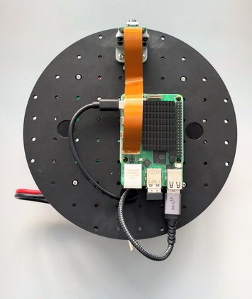](guide-images/30.jpg) [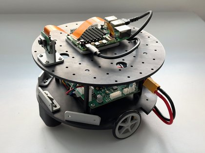](guide-images/31.jpg) [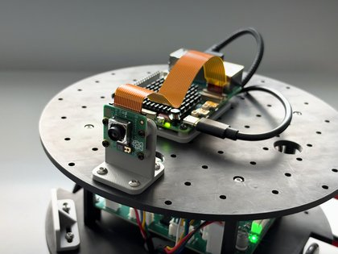](guide-images/32.jpg)

---

## Software

These steps give you a Frindo you can drive from a keyboard over ROS 2. Keep the battery unplugged
until the Raspberry Pi is fitted and its cables are connected.

### Step 16: Set up the Raspberry Pi

Follow *Deploying on a Raspberry Pi* in section 8 of the MC1 guide, which installs Ubuntu Server 24.04,
ROS 2 Jazzy and the driver. Use a 64 GB A2-rated microSD card. There are two things to do as you go:

- **Use these USB IDs for the `/dev/mc1` rule.** The rule printed in the MC1 guide has older IDs, which
  do not match current boards:

  ```bash
  sudo tee /etc/udev/rules.d/99-motion-core.rules >/dev/null <<'RULES'
  SUBSYSTEM=="tty", ATTRS{idVendor}=="0483", ATTRS{idProduct}=="a5f6", SYMLINK+="mc1", ENV{ID_MM_DEVICE_IGNORE}="1"
  SUBSYSTEM=="tty", ATTRS{idVendor}=="0483", ATTRS{idProduct}=="a5ea", SYMLINK+="mc1-boot", ENV{ID_MM_DEVICE_IGNORE}="1"
  RULES
  sudo udevadm control --reload-rules && sudo udevadm trigger
  ```

- **Allow the Pi 5 its full USB current.** The Pi 5 limits its USB ports to 600 mA in total unless it
  detects a 5 A supply, and it will not detect one on this cable. MC1's J4 output can supply up to 6 A,
  so add this to `/boot/firmware/config.txt` and reboot:

  ```ini
  [pi5]
  usb_max_current_enable=1
  ```

### Step 17: Drive the robot

With the Pi fitted, the robot can no longer rest on its deck, so stand it on a block for the first
run to keep the wheels off the ground. You will need the keyboard teleop package, then two
terminals on the Pi:

```bash
sudo apt install ros-jazzy-teleop-twist-keyboard

# Terminal 1: the driver
ros2 run orcp_ros2 orcp_driver --ros-args -p port:=/dev/mc1

# Terminal 2: keyboard control
ros2 run teleop_twist_keyboard teleop_twist_keyboard
```

MC1 starts in its `SLOW` preset, which limits the motors to 30% duty, so you can drive straight away.
Once the wheels respond correctly, put the robot on the floor. Section 10 of the MC1 guide covers the
faster `NORMAL` preset and adding a game controller.

When you have finished, press Ctrl-C in both terminals and run `sudo shutdown now` on the Pi. Wait for
it to shut down before you switch off, because losing power during a write can corrupt the microSD
card.

> **Draft note, remove before release:** camera setup is not covered yet. The camera software needs
> Raspberry Pi's own version of libcamera, and the scripts for it are not public yet. See
> `pi_build_libcamera.sh` and `pi_camera_mjpeg.py` in the MC1 repo's `docs/examples`.
