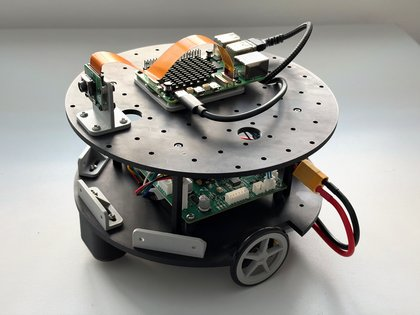

# Frindo

The open robot you print yourself: a 3D-printed chassis, an exact parts list, and closed-loop motor
control with ROS 2 or Python.

Frindo began in 2009 as an open robotics platform, with published drawings, free to download and
build yourself. This version is redrawn to print on a standard desktop 3D printer. Motion control
comes from Motion Core MC1, a commercial motor controller that handles closed-loop control, current
limiting and encoder odometry for you.

## Start here

- [Build guide](BUILD.md): 17 steps, from printing the parts to driving the robot
- [Bill of materials](BUILD.md#bill-of-materials)
- [3D print files](3D%20files): STL files, plus ready-made print sets in `.3mf`

## What you need

- A desktop 3D printer. Everything prints in about 8 hours, using roughly 310 g of PLA.
- A [Motion Core MC1](https://firstlayerrobotics.com/motion-core) motor controller
- Two 12 V gearmotors with encoders, and a 3S LiPo battery
- A Raspberry Pi 5 and camera, for the robot in the build guide. The deck can carry other electronics.

## Software

Frindo sends velocity commands to MC1 and gets odometry back, over the open
[ORCP](https://github.com/orcp-protocol/orcp) serial protocol. You can drive it with either of these:

- **ROS 2:** [`orcp-ros2`](https://github.com/orcp-protocol/orcp-ros2) and the
  [Getting Started guide for ROS 2](https://firstlayerrobotics.com/Motion_Core_Getting_Started_ROS2_Rev_C.pdf)
- **Python:** [`orcp-python`](https://github.com/orcp-protocol/orcp-python) and the
  [Getting Started guide for Python](https://firstlayerrobotics.com/Motion_Core_Getting_Started_Python_Rev_C.pdf)

## Licence

The robot's design files and this documentation are released under
[CC BY-SA 4.0](LICENSE). You may modify, print and sell them, as long as you give credit and share
your changes under the same licence. The image script, `make-guide-images.py`, is under the MIT
licence, as stated in the file.

To give credit, use: *Frindo by Jonathan Luke, [frindo.org](https://frindo.org)*.

This does not cover:

- **Motion Core MC1**, which is a commercial product and is not open source.
- **The Frindo name.** Frindo™ is a trade mark of Jonathan Luke. If you sell or publish your own
  version, please give it a different name.

## More

[frindo.org](https://frindo.org) · [hello@frindo.org](mailto:hello@frindo.org)
